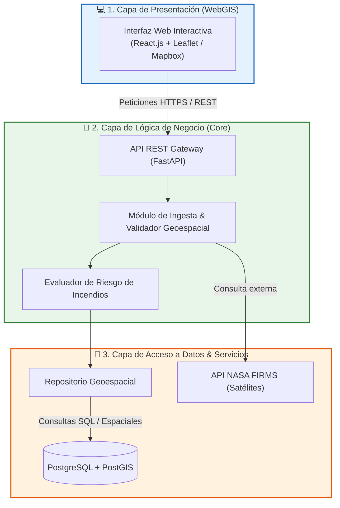

# Arquitectura Lógica Inicial del Sistema

## 1. Descripción de la Arquitectura Base

Como punto de partida para el desarrollo incremental del prototipo, se definió una **Arquitectura Lógica en Tres Capas**, cuyo objetivo es establecer una separación clara de responsabilidades básicas antes de incorporar la comunicación asíncrona distribuida.

---

## 2. Detalle de las Capas Iniciales

### 2.1. Capa de Presentación (WebGIS)
* **Tecnologías:** React.js, Leaflet, Tailwind CSS.
* **Responsabilidad:** Renderizar mapas con marcadores térmicos, mapas de calor (*heatmaps*), filtros por fecha/región y panel de control de alertas activas para los analistas.

### 2.2. Capa de Lógica de Negocio
* **Tecnologías:** Python 3.11, FastAPI.
* **Responsabilidad:**
  * Validar las coordenadas geográficas (latitud, longitud) y normalizar el formato de temperatura de brillo (Kelvin/Celsius).
  * Evaluar si la anomalía térmica cae dentro del polígono del territorio peruano.
  * Aplicar la matriz inicial de clasificación de riesgo (Bajo, Medio, Alto, Crítico).

### 2.3. Capa de Acceso a Datos e Integración
* **Tecnologías:** PostgreSQL 16, Extensión PostGIS 3.4, SQLAlchemy / GeoAlchemy2.
* **Responsabilidad:**
  * Conectarse a la API de NASA FIRMS para la ingesta periódica de registros.
  * Almacenar datos vectoriales en tablas espaciales (`GEOMETRY(Point, 4326)`).
  * Ejecutar consultas geométricas complejas (`ST_Contains`, `ST_Buffer`, `ST_DWithin`).

---

## 3. Justificación de la Transición hacia la Arquitectura EDA

Aunque la arquitectura en tres capas inicial permitió estructurar el prototipo de forma comprensible, presentó las siguientes **limitaciones técnicas** ante el escenario real de incendios forestales:

1. **Acoplamiento Sincrónico:** Si la API de NASA FIRMS experimenta alta latencia o caídas, la interfaz de usuario se bloquea esperando la respuesta.
2. **Cuello de Botella en Lectura/Escritura:** El procesamiento por lotes (*batch*) directo contra la base de datos ralentiza las consultas de mapas en tiempo real durante emergencias.
3. **Falta de Escalabilidad Horizontal:** Imposibilidad de escalar únicamente el componente de alertas sin duplicar todo el servidor backend.

Por ello, esta arquitectura inicial evoluciona hacia una **Arquitectura Orientada a Eventos (EDA)** con microservicios desacoplados.