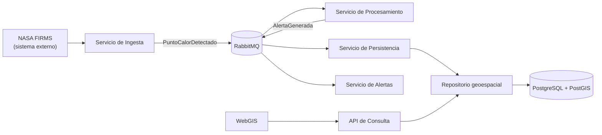

# Componentes Arquitectónicos

Este documento separa capacidades funcionales, contenedores C4, servicios
propuestos y tecnologías. Los servicios descritos aquí son diseño previsto;
no se presentan como implementados.

## Módulos funcionales

| Módulo | Responsabilidad | Funciones principales |
| :--- | :--- | :--- |
| Gestión de Datos Satelitales | Incorporar observaciones externas | Consultar la fuente, adaptar formatos, validar estructura y publicar eventos. |
| Gestión de Puntos de Calor | Administrar el ciclo de vida de observaciones | Registrar, deduplicar, consultar y conservar puntos de calor. |
| Evaluación Experimental del Riesgo | Aplicar reglas versionadas a una observación | Combinar atributos disponibles, contexto territorial y producir un nivel experimental. |
| Monitoreo Geoespacial | Presentar información territorial | Consultar puntos, capas y evaluaciones; representar mapas y filtros. |
| Gestión de Alertas | Gestionar resultados que requieren notificación | Crear eventos de alerta experimental, registrar su estado y distribuirlos por canales configurados. |
| Administración del Sistema | Controlar operación y acceso | Gestionar usuarios, roles, parámetros, fuentes y auditoría. |

RabbitMQ, PostgreSQL, PostGIS, FastAPI, Python, React y Leaflet son tecnologías
o infraestructura. No son módulos funcionales. Los microservicios son una
posible división de implementación y tampoco son sinónimos de módulos.

## Servicios propuestos

| Servicio propuesto | Responsabilidad | Módulos atendidos |
| :--- | :--- | :--- |
| Servicio de Ingesta Satelital | Adaptar una fuente y publicar `PuntoCalorDetectado` | Gestión de Datos Satelitales |
| Servicio de Procesamiento | Consumir, validar y evaluar observaciones | Gestión de Puntos de Calor; Evaluación Experimental del Riesgo |
| Servicio de Persistencia Geoespacial | Consumir eventos y persistirlos mediante un repositorio | Gestión de Puntos de Calor |
| Servicio de Alertas | Consumir `AlertaGenerada` y coordinar canales | Gestión de Alertas |
| API de Consulta y WebGIS | Exponer consultas y representar información | Monitoreo Geoespacial |
| Administración | Exponer operaciones protegidas de configuración | Administración del Sistema |

## Flujo EDA propuesto

La persistencia se realiza mediante un consumidor y un repositorio; RabbitMQ no
escribe directamente en PostgreSQL.
