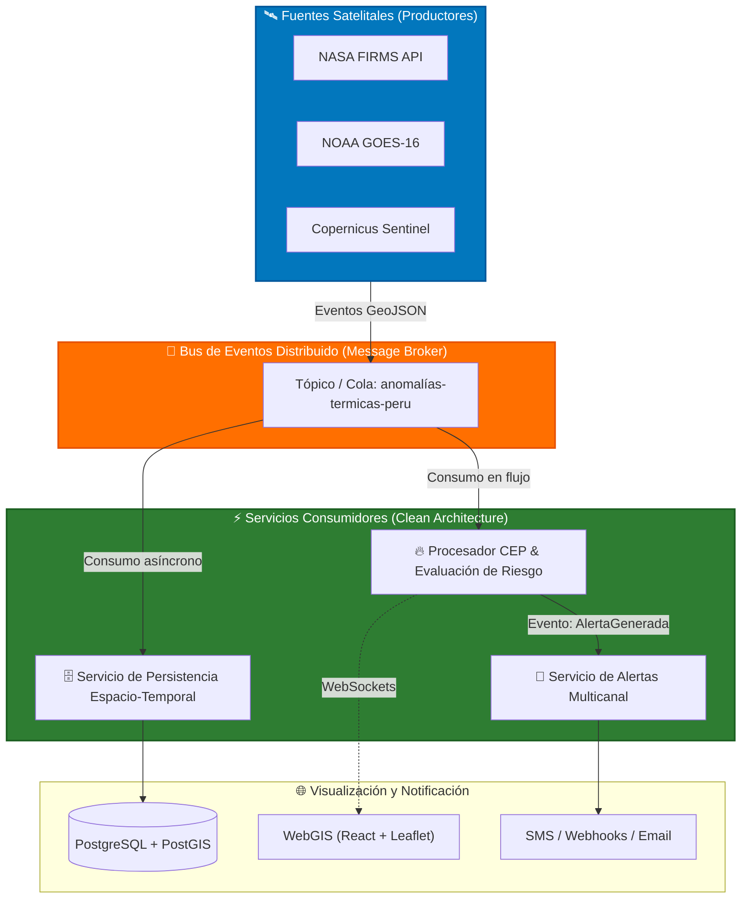

# Enfoque Arquitectónico del Sistema

## 1. Visión General del Enfoque

El sistema para el **Monitoreo de Puntos de Calor Satelitales y Generación de Alertas de Riesgo de Incendios Forestales en el Perú** adopta un enfoque híbrido centrado en la **Arquitectura Dirigida por Eventos (Event-Driven Architecture - EDA)**, complementado con principios de **Clean Architecture** (Arquitectura Limpia) y un esquema de **Microservicios Especializados**.

Este enfoque responde a la naturaleza de la información satelital ambiental (NASA FIRMS, Copernicus, GOES-16), caracterizada por flujos asíncronos, picos masivos de datos durante temporadas secas e integración con múltiples actores institucionales (COEN, INDECI, SERFOR, Brigadistas).

---

## 2. Principios Rectores del Enfoque

1. **Desacoplamiento Temporal y Espacial:** Los componentes productores de eventos (ingesta satelital) no conocen la existencia ni la ubicación física de los componentes consumidores (evaluador de riesgo, base de datos, notificaciones).
2. **Procesamiento de Flujos en Tiempo Casi Real (Stream Processing):** Los datos térmicos emitidos por sensores satelitales no se procesan mediante lotes (*batch*) tradicionales, sino en tiempo real conforme arriban al Bus de Eventos.
3. **Independencia del Dominio (Clean / Hexagonal Architecture):** Las reglas de clasificación de riesgo por incendios y cálculo de temperaturas de brillo permanecen aisladas de los marcos de trabajo (*frameworks*), bases de datos y proveedores externos.
4. **Resiliencia Geoespacial:** La caída temporal de un proveedor externo de datos satelitales o de un servicio de notificaciones no interrumpe el funcionamiento ni provoca la pérdida de datos en el núcleo del sistema.

---

## 3. Relación con los Atributos de Calidad

| Atributo de Calidad | Decisión de Enfoque | Impacto en el Sistema |
| :--- | :--- | :--- |
| **AC01 - Rendimiento** | Uso de un Message Broker asíncrono (RabbitMQ / Apache Kafka) | Minimiza la latencia de procesamiento a menos de 3 segundos desde la ingesta. |
| **AC02 - Escalabilidad** | Particionamiento regional de temas/colas de mensajes | Permite escalar horizontalmente consumidores durante emergencias por incendios en la Amazonía. |
| **AC03 - Resiliencia** | Patrón Circuit Breaker y cola de reintentos (*Dead Letter Queue*) | Retiene los eventos satelitales ante fallas de red sin perder información histórica. |
| **AC04 - Seguridad** | API Gateway centralizado con autenticación JWT / OAuth2 | Protege la capa de servicios expuestos al WebGIS y controla permisos por rol. |
| **AC05 - Mantenibilidad** | Separación estricta de responsabilidades por capas y servicios | Permite actualizar algoritmos de riesgo o proveedores sin afectar la ingesta de datos. |

---

## 4. Diagrama del Enfoque Arquitectónico

