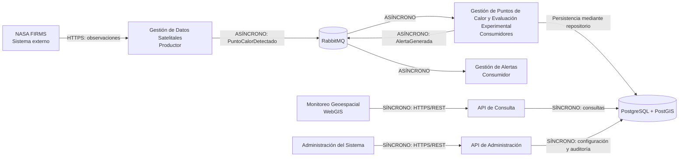

# Enfoque Arquitectónico del Sistema

## 1. Enfoque general

El sistema adopta la **Arquitectura Orientada a Eventos (EDA)** como estilo
principal. La ingesta, evaluación, persistencia y generación de alertas se
desacoplan mediante eventos transportados por RabbitMQ. Las consultas del
WebGIS y la administración se realizan mediante una API REST síncrona.

Microservicios es una organización distribuida propuesta, no una obligación
de crear un servicio por cada módulo funcional. La arquitectura en capas
representa la organización inicial; Clean Architecture y arquitectura
hexagonal orientan el diseño interno mediante casos de uso, puertos y
adaptadores.

La fuente satelital priorizada en el alcance actual es NASA FIRMS. Copernicus,
GOES-16 y otras fuentes pueden incorporarse posteriormente mediante nuevos
adaptadores, sin presentarse como integraciones existentes.

## 2. Relación con los módulos funcionales

Los seis módulos funcionales son:

1. **Gestión de Datos Satelitales:** obtiene, valida y normaliza observaciones.
2. **Gestión de Puntos de Calor:** registra, consulta y administra observaciones.
3. **Evaluación Experimental del Riesgo:** aplica reglas versionadas y experimentales.
4. **Monitoreo Geoespacial:** visualiza observaciones y evaluaciones en mapas.
5. **Gestión de Alertas:** genera, registra y presenta notificaciones experimentales.
6. **Administración del Sistema:** administra usuarios, permisos, configuración y auditoría.

Los módulos son capacidades funcionales. RabbitMQ, PostgreSQL, PostGIS,
FastAPI, Python, React y Leaflet son infraestructura o tecnologías previstas.

## 3. Decisiones de enfoque

| Decisión | Justificación | Estado |
| :--- | :--- | :--- |
| EDA con RabbitMQ | Desacopla productores y consumidores y permite procesar eventos de forma asíncrona. | Propuesta |
| API REST | Permite consultas síncronas del WebGIS y operaciones administrativas. | Propuesta |
| Clean Architecture | Mantiene las reglas de dominio independientes de frameworks y proveedores. | Propuesta |
| Arquitectura hexagonal | Define puertos para eventos, persistencia, fuentes y notificaciones. | Propuesta |
| Microservicios | Permite distribuir responsabilidades cuando el tamaño y las pruebas lo justifiquen. | Propuesta |

No se declara una latencia, escalabilidad o tolerancia a fallos como resultado
obtenido. Esos atributos requieren escenarios, instrumentación y pruebas.

## 4. Flujo de eventos y consultas

La vista modular completa se documenta en
[estilo-arquitectonico.md](../estilo-arquitectonico.md). El flujo conceptual es:

El broker no escribe directamente en la base de datos. Un consumidor o
servicio de persistencia utiliza un repositorio para guardar los eventos.

## 5. Estado de implementación

El repositorio actual contiene un boilerplate Angular de marketplace y no
contiene todavía la integración NASA FIRMS, los servicios Python/FastAPI,
RabbitMQ ni PostgreSQL/PostGIS descritos en este enfoque.
