# Estilo Arquitectónico

## EDA como estilo principal

La Arquitectura Orientada a Eventos (EDA) es el estilo principal propuesto.
Los productores publican eventos y los consumidores reaccionan de forma
asíncrona mediante un broker. El diseño no implica que todos los flujos sean
asíncronos: las consultas del WebGIS pueden usar HTTP/REST hacia una API.

Eventos propuestos:

- `PuntoCalorDetectado`: observación normalizada, no incendio confirmado.
- `EvaluacionRiesgoCalculada`: resultado experimental versionado.
- `AlertaGenerada`: resultado que cumple una regla de notificación configurada.

## Arquitectura inicial en capas

La arquitectura inicial en capas sirve como modelo de separación para el
prototipo:

1. **Presentación:** WebGIS y API de consulta.
2. **Aplicación y dominio:** casos de uso, validación y evaluación experimental.
3. **Adaptadores e infraestructura:** fuentes externas, broker y persistencia.

La evolución a EDA desacopla los flujos de ingesta, procesamiento,
persistencia y notificación; no elimina la separación de responsabilidades.

## «Vista modular y flujo de eventos – Arquitectura Orientada a Eventos (EDA)»

El siguiente diagrama muestra los seis módulos funcionales, los servicios que
podrían implementar sus responsabilidades y la infraestructura. Es un diseño
propuesto; no representa una implementación existente.

```mermaid
flowchart TB

    %% =========================================================
    %% ACTORES
    %% =========================================================
    USR["Usuario de Monitoreo"]
    ADM["Administrador"]

    WEB["Cliente Web<br/>[ Navegador · React · Leaflet ]"]

    USR --> WEB
    ADM --> WEB

    %% =========================================================
    %% SISTEMA PRINCIPAL
    %% =========================================================
    subgraph SISTEMA["<<sistema>> Monitoreo Satelital Backend<br/>Propuesta inicial del sistema"]
        direction TB

        MW["Servicios transversales / adaptadores de entrada<br/>autenticación · validación · manejo de errores · logging"]

        %% ================= CAPA 1 =================
        subgraph CAPA1[" "]
            direction LR

            L1["1. CAPA DE<br/>PRESENTACIÓN<br/><br/>Recibe peticiones HTTP<br/>valida entrada y<br/>responde JSON"]

            subgraph MOD1P["módulo datos-satelitales"]
                direction TB
                P11["ingesta.scheduler.py"]
                P12["firms.controller.py"]
            end

            subgraph MOD2P["módulo puntos-calor"]
                direction TB
                P21["puntos.routes.py"]
                P22["puntos.controller.py"]
            end

            subgraph MOD3P["módulo evaluacion-riesgo"]
                direction TB
                P31["riesgo.routes.py"]
                P32["riesgo.controller.py"]
            end

            subgraph MOD4P["módulo monitoreo"]
                direction TB
                P41["monitoreo.routes.py"]
                P42["monitoreo.controller.py"]
            end

            subgraph MOD5P["módulo alertas"]
                direction TB
                P51["alertas.routes.py"]
                P52["alertas.controller.py"]
            end

            subgraph MOD6P["módulo administracion"]
                direction TB
                P61["admin.routes.py"]
                P62["admin.controller.py"]
            end
        end

        %% ================= CAPA 2 =================
        subgraph CAPA2[" "]
            direction LR

            L2["2. CAPA DE<br/>LÓGICA DE NEGOCIO<br/><br/>Reglas de negocio<br/>y coordinación entre módulos"]

            subgraph MOD1S["módulo datos-satelitales"]
                direction TB
                S11["satelital.service.py<br/>obtener, validar y normalizar"]
            end

            subgraph MOD2S["módulo puntos-calor"]
                direction TB
                S21["puntos_calor.service.py<br/>registro, deduplicación y consulta"]
            end

            subgraph MOD3S["módulo evaluacion-riesgo"]
                direction TB
                S31["riesgo.service.py<br/>clasificación experimental"]
            end

            subgraph MOD4S["módulo monitoreo"]
                direction TB
                S41["monitoreo.service.py<br/>mapas, filtros e historial"]
            end

            subgraph MOD5S["módulo alertas"]
                direction TB
                S51["alertas.service.py<br/>generación y distribución"]
            end

            subgraph MOD6S["módulo administracion"]
                direction TB
                S61["admin.service.py<br/>usuarios, roles y auditoría"]
            end
        end

        %% ================= CAPA 3 =================
        subgraph CAPA3[" "]
            direction LR

            L3["3. CAPA DE<br/>DATOS / INFRAESTRUCTURA<br/><br/>Persistencia y acceso<br/>a recursos externos"]

            subgraph MOD1R["módulo datos-satelitales"]
                direction TB
                R11["firms.adapter.py"]
            end

            subgraph MOD2R["módulo puntos-calor"]
                direction TB
                R21["puntos.repository.py"]
            end

            subgraph MOD3R["módulo evaluacion-riesgo"]
                direction TB
                R31["riesgo.repository.py"]
            end

            subgraph MOD4R["módulo monitoreo"]
                direction TB
                R41["monitoreo.repository.py"]
            end

            subgraph MOD5R["módulo alertas"]
                direction TB
                R51["alertas.repository.py"]
            end

            subgraph MOD6R["módulo administracion"]
                direction TB
                R61["admin.repository.py"]
            end
        end

        SHARED["Acceso compartido a persistencia y mensajería<br/>PostgreSQL / PostGIS · RabbitMQ · adaptadores externos"]
    end

    %% =========================================================
    %% RELACIONES INTERNAS
    %% =========================================================
    WEB -->|"HTTPS / JSON"| MW

    MW --> P11
    MW --> P21
    MW --> P31
    MW --> P41
    MW --> P51
    MW --> P61

    P11 --> P12 --> S11 --> R11
    P21 --> P22 --> S21 --> R21
    P31 --> P32 --> S31 --> R31
    P41 --> P42 --> S41 --> R41
    P51 --> P52 --> S51 --> R51
    P61 --> P62 --> S61 --> R61

    R11 --> SHARED
    R21 --> SHARED
    R31 --> SHARED
    R41 --> SHARED
    R51 --> SHARED
    R61 --> SHARED

    %% =========================================================
    %% SISTEMAS EXTERNOS
    %% =========================================================
    NASA["<<sistema externo>><br/>NASA FIRMS"]
    CANALES["<<sistema externo>><br/>Canales de notificación<br/>Email / SMS / Webhook"]
    DB[("PostgreSQL + PostGIS<br/>monitoreo_db")]
    MQ[("RabbitMQ<br/>broker de eventos")]

    NASA -->|"HTTPS / CSV / JSON"| R11
    S51 -->|"Entrega de notificación"| CANALES
    SHARED -->|"SQL / TCP"| DB
    SHARED -->|"AMQP"| MQ

    %% =========================================================
    %% ESTILOS
    %% =========================================================
    classDef actor fill:#f8fafc,stroke:#475569,color:#0f172a,stroke-width:1.5px
    classDef cliente fill:#eef2ff,stroke:#4f46e5,color:#312e81,stroke-width:2px
    classDef transversal fill:#dbeafe,stroke:#2563eb,color:#1e3a8a,stroke-width:2px
    classDef capa fill:#f8fafc,stroke:#94a3b8,color:#111827,stroke-width:1px
    classDef capaLabel fill:#dbeafe,stroke:#2563eb,color:#1e3a8a,stroke-width:2px
    classDef presentacion fill:#eff6ff,stroke:#3b82f6,color:#1e3a8a,stroke-width:2px
    classDef negocio fill:#f0fdf4,stroke:#22c55e,color:#14532d,stroke-width:2px
    classDef datos fill:#fef3c7,stroke:#f59e0b,color:#92400e,stroke-width:2px
    classDef shared fill:#fefce8,stroke:#ca8a04,color:#713f12,stroke-width:2px
    classDef externo fill:#f3e8ff,stroke:#7c3aed,color:#4c1d95,stroke-width:2px
    classDef storage fill:#e2e8f0,stroke:#475569,color:#0f172a,stroke-width:2px

    class USR,ADM actor
    class WEB cliente
    class MW transversal

    class L1,L2,L3 capaLabel

    class P11,P12,P21,P22,P31,P32,P41,P42,P51,P52,P61,P62 presentacion
    class S11,S21,S31,S41,S51,S61 negocio
    class R11,R21,R31,R41,R51,R61 datos
    class SHARED shared

    class NASA,CANALES externo
    class DB,MQ storage

    style SISTEMA fill:#ffffff,stroke:#64748b,stroke-width:2px,stroke-dasharray: 6 6
    style CAPA1 fill:#ffffff,stroke:#60a5fa,stroke-width:1px
    style CAPA2 fill:#ffffff,stroke:#4ade80,stroke-width:1px
    style CAPA3 fill:#ffffff,stroke:#fbbf24,stroke-width:1px
```

RabbitMQ no persiste directamente en PostgreSQL. El Servicio de Persistencia
consume los eventos y utiliza un repositorio para guardar la información. Las
consultas del WebGIS y las operaciones administrativas son síncronas mediante
API REST; la ingesta, evaluación, persistencia y alertas se desacoplan con
eventos.

## Clean Architecture y arquitectura hexagonal

El dominio y los casos de uso dependen de puertos, no de FastAPI, RabbitMQ,
PostgreSQL o SDK de una fuente. Los adaptadores de entrada incluyen
consumidores de eventos y endpoints; los adaptadores de salida incluyen el
publicador, repositorio y clientes externos.

Esta organización es un diseño propuesto. El código real inspeccionado es un
boilerplate Angular de marketplace y no contiene estos servicios.

## Tecnologías previstas

| Área | Tecnología prevista | Estado comprobado |
| :--- | :--- | :--- |
| Fuente | NASA FIRMS | No integrada en el código actual |
| Backend | Python, FastAPI | No presente en el código actual |
| Mensajería | RabbitMQ | No presente en el código actual |
| Persistencia | PostgreSQL, PostGIS | No presente en el código actual |
| Presentación | React, Leaflet | No presente; el boilerplate usa Angular |

## Principios y patrones

- **SOLID:** guía para separar casos de uso, puertos y adaptadores; no prueba
  que las clases propuestas ya existan.
- **Adapter:** convierte el contrato de NASA FIRMS al modelo interno.
- **Strategy:** permite comparar reglas experimentales de evaluación.
- **Repository:** encapsula persistencia y consultas geoespaciales.
- **Publish/Subscribe:** desacopla productores y consumidores mediante eventos.

Estos patrones son decisiones de diseño propuestas, no implementaciones
verificadas en el sistema de monitoreo.
