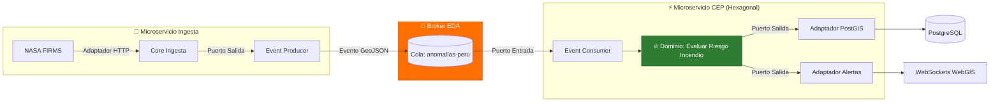

# Estilos Arquitectónicos Seleccionados

El diseño del sistema de monitoreo de incendios forestales combina estratégicamente tres estilos arquitectónicos complementarios para satisfacer los atributos de calidad requeridos.

---

## 1. Análisis de Estilos Arquitectónicos

### 1.1. Arquitectura Orientada a Eventos (EDA - Estilo Principal)
* **Descripción:** Los componentes interactúan mediante la emisión, detección y consumo de eventos térmicos georreferenciados.
* **Rol en el Sistema:** Controla todo el ciclo de vida del dato desde la ingesta satelital hasta la notificación de peligro.
* **Mecanismos:**
  * **Event Producer:** Servicio de Ingesta Satelital (NASA FIRMS / GOES-16).
  * **Event Broker:** RabbitMQ / Apache Kafka con soporte para colas regionales.
  * **Event Consumer:** Servicio CEP de evaluación de riesgo, Servicio de Notificaciones, Servicio de Persistencia.

### 1.2. Arquitectura de Microservicios
* **Descripción:** División de las capacidades del sistema en servicios autónomos con bases de datos o esquemas especializados, desplegados de forma independiente mediante contenedores Docker.
* **Microservicios Definidos:**
  1. `ms-ingesta-satelital`: Polling e ingesta de APIs públicas.
  2. `ms-procesador-cep`: Motor de reglas y evaluación de riesgo térmico.
  3. `ms-notificaciones-alertas`: Despacho multicanal de alertas (SMS, Webhooks, WebSockets).
  4. `ms-api-webgis`: Gateway de lectura de mapas e historial.

### 1.3. Arquitectura Hexagonal (Puertos y Adaptadores)
* **Descripción:** Aísla el núcleo del dominio (cálculo de riesgo por incendio) de las dependencias externas (RabbitMQ, PostGIS, FastAPI, APIs satelitales).
* **Aplicación:** Permite sustituir la tecnología de mensajería (ejemplo: cambiar RabbitMQ por Kafka) o la pasarela de SMS sin modificar una sola línea de código de las reglas de negocio.

---

## 2. Matriz Comparativa de Estilos Arquitectónicos

| Criterio de Evaluación | Monolito Tradicional | Arquitectura en Capas | Microservicios + EDA (Seleccionado) |
| :--- | :--- | :--- | :--- |
| **Latencia de Alerta** | Alta (Procesamiento Batch) | Media | **Muy Baja (< 3s)** |
| **Tolerancia a Fallas** | Baja (Punto único de falla) | Media | **Alta (Aislamiento por microservicio)** |
| **Escalabilidad** | Monolítica (Costosa) | Vertical | **Horizontal independiente por evento** |
| **Desacoplamiento** | Bajo | Moderado (Lógico) | **Estrictamente Desacoplado** |
| **Complejidad de Operación** | Muy Baja | Baja | **Media-Alta (Orquestado con Docker)** |

---

## 3. Integración de los Estilos Arquitectónicos

