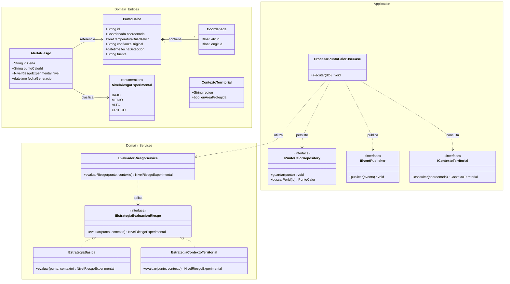
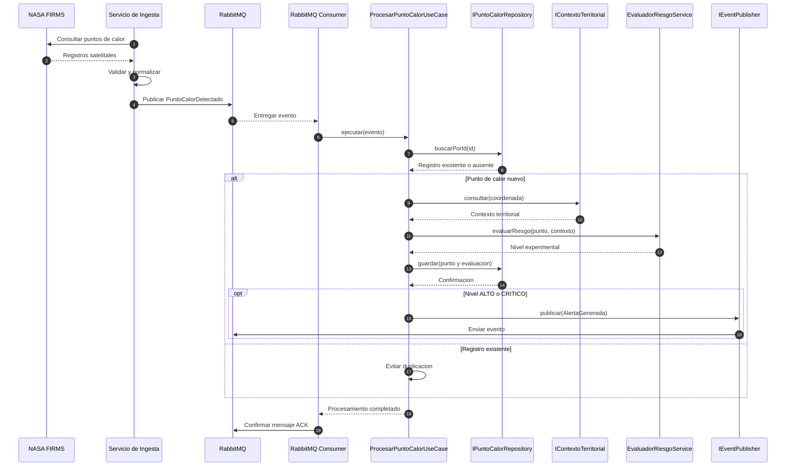

# Diseño Interno de Software: Principios, Patrones y Estructura de Módulos

**Proyecto:** Arquitectura de Software Orientada a Eventos para el Monitoreo Satelital de Incendios Forestales.

---

## PARTE 1: Principios de Diseño SOLID

La aplicación de los principios **SOLID** en el diseño interno del sistema busca mejorar la mantenibilidad, extensibilidad y capacidad de prueba de los componentes que procesarán los datos satelitales.

El sistema estará organizado en seis módulos funcionales:

1. **Gestión de Datos Satelitales:** Obtención, validación y normalización de registros de NASA FIRMS.
2. **Gestión de Puntos de Calor:** Registro, consulta y administración de detecciones satelitales.
3. **Evaluación Experimental del Riesgo:** Aplicación de reglas para clasificar las detecciones.
4. **Monitoreo Geoespacial:** Visualización y consulta de puntos de calor mediante mapas.
5. **Gestión de Alertas:** Generación, registro y notificación de alertas experimentales.
6. **Administración del Sistema:** Gestión de usuarios, permisos, configuración y auditoría.

Estos módulos representan las funcionalidades del sistema y no deben confundirse con microservicios, bases de datos o herramientas tecnológicas.

### 1. SRP – Single Responsibility Principle (Principio de Responsabilidad Única)

Cada clase o componente tendrá una responsabilidad específica dentro de los módulos funcionales:

- **`FIRMSIngestionService`:** Responsable de coordinar la obtención periódica de datos satelitales mediante NASA FIRMS.

- **`NASAFirmsAdapter`:** Encargado de transformar los datos externos en objetos de dominio `PuntoCalor`.

- **`EvaluadorRiesgoService`:** Responsable de evaluar los puntos de calor utilizando reglas experimentales de clasificación.

- **`PuntoCalorRepository`:** Encargado de administrar las operaciones de almacenamiento y consulta de puntos de calor.

- **`RabbitMQEventPublisher`:** Responsable de publicar eventos en RabbitMQ.

De esta manera, cada componente tendrá una responsabilidad definida, evitando concentrar funciones independientes en una misma clase.

### 2. OCP – Open/Closed Principle (Principio Abierto/Cerrado)

Los componentes deberán permitir la incorporación de nuevas funcionalidades sin modificar constantemente su lógica principal.

- Mediante la interfaz `IEstrategiaEvaluacionRiesgo`, será posible incorporar diferentes algoritmos de clasificación.

- Se podrá utilizar inicialmente `EstrategiaBasica`, basada en atributos satelitales disponibles.

- Posteriormente, se podrá agregar `EstrategiaContextoTerritorial`, que considere información geográfica complementaria.

- En futuras versiones, será posible incorporar datos meteorológicos mediante nuevas estrategias.

Las reglas y umbrales de clasificación deberán estar documentados y ser evaluados experimentalmente.

### 3. LSP – Liskov Substitution Principle (Principio de Sustitución de Liskov)

Las implementaciones concretas deberán respetar los contratos establecidos por sus interfaces.

- Se definirá la interfaz `IFuenteSatelital` para obtener registros satelitales estandarizados.

- La clase `NASAFirmsAdapter` implementará inicialmente este contrato.

- En versiones futuras podrán incorporarse adaptadores para otras fuentes, siempre que respeten los atributos, tipos de datos y comportamientos esperados.

Esto permitirá sustituir implementaciones compatibles sin alterar las operaciones principales del sistema.

### 4. ISP – Interface Segregation Principle (Principio de Segregación de Interfaces)

Se utilizarán interfaces específicas en lugar de contratos demasiado generales.

- **`IFuenteSatelital`:** Define operaciones de obtención de datos satelitales.

- **`IPuntoCalorRepository`:** Define operaciones de almacenamiento y consulta.

- **`IEstrategiaEvaluacionRiesgo`:** Define operaciones de evaluación experimental.

- **`IEventPublisher`:** Define operaciones de publicación de eventos.

- **`INotificadorAlertas`:** Define operaciones de notificación.

Cada componente dependerá únicamente de las interfaces necesarias para cumplir su responsabilidad.

### 5. DIP – Dependency Inversion Principle (Principio de Inversión de Dependencias)

Los casos de uso del sistema dependerán de abstracciones y no directamente de tecnologías externas.

- El caso de uso `ProcesarPuntoCalorUseCase` dependerá de las interfaces `IPuntoCalorRepository`, `IEventPublisher` e `IContextoTerritorial`.

- Las implementaciones concretas utilizarán tecnologías como PostgreSQL, PostGIS y RabbitMQ.

- Esto permitirá realizar pruebas unitarias mediante repositorios y publicadores simulados (*Mocks*) sin necesidad de ejecutar toda la infraestructura.

---

## PARTE 2: Patrones de Diseño Propuestos

Para resolver problemas recurrentes de integración, procesamiento y almacenamiento se propone aplicar patrones de diseño y patrones de integración.

Estos patrones se seleccionarán de acuerdo con las necesidades de los módulos funcionales.

### 1. Patrón Adapter (Estructural)

- **Propósito:** Transformar los datos obtenidos de una fuente externa al formato interno utilizado por el sistema.

- **Módulo relacionado:** Gestión de Datos Satelitales.

- **Aplicación:** La clase `NASAFirmsAdapter` transformará registros provenientes de NASA FIRMS en entidades de dominio `PuntoCalor`.

- **Atributos utilizados:** `latitude`, `longitude`, `bright_ti4`, `confidence`, `acq_date` y `acq_time`, según el producto satelital consultado.

- **Beneficio:** Permite separar los formatos externos de las representaciones internas.

Los atributos de temperatura y confianza se interpretarán conforme a la documentación del producto satelital, sin asumir que representan directamente la temperatura de las llamas o porcentajes universales.

### 2. Patrón Strategy (Comportamiento)

- **Propósito:** Permitir el intercambio de algoritmos de evaluación sin modificar el procesamiento principal.

- **Módulo relacionado:** Evaluación Experimental del Riesgo.

- **Aplicación:** Se utilizará la interfaz `IEstrategiaEvaluacionRiesgo`.

- **Implementaciones propuestas:**
  - `EstrategiaBasica`
  - `EstrategiaContextoTerritorial`
  - `EstrategiaMeteorologica` (futura)

- **Beneficio:** Facilita incorporar nuevas reglas de evaluación.

Las categorías de riesgo serán experimentales y no representarán alertas oficiales de incendios confirmados.

### 3. Patrón Repository (Persistencia)

- **Propósito:** Encapsular las operaciones de acceso y persistencia de información.

- **Módulo relacionado:** Gestión de Puntos de Calor.

- **Aplicación:** La interfaz `IPuntoCalorRepository` establecerá operaciones como:

  - `guardar(punto)`
  - `buscarPorId(id)`
  - `obtenerPorRegion(region)`
  - `obtenerPorRangoFechas(inicio, fin)`

- **Implementación:** `PuntoCalorPostGISRepository`.

- **Beneficio:** Separa las reglas de negocio de las consultas SQL y del motor de almacenamiento.

### 4. Patrón Publish/Subscribe (Integración EDA)

- **Propósito:** Desacoplar la producción de eventos de los componentes encargados de consumirlos.

- **Módulos relacionados:** Gestión de Datos Satelitales, Gestión de Puntos de Calor, Evaluación Experimental del Riesgo y Gestión de Alertas.

- **Aplicación:** El servicio de ingesta publicará el evento `PuntoCalorDetectado` mediante RabbitMQ.

- El servicio de procesamiento consumirá el evento para validar y evaluar el registro.

- Cuando corresponda generar una alerta experimental, se publicará el evento `AlertaGenerada`.

- **Beneficio:** Facilita la comunicación asíncrona y reduce dependencias directas entre determinados componentes.

RabbitMQ será el componente de infraestructura encargado de transportar y distribuir los mensajes, no un módulo funcional.

### 5. Patrón Circuit Breaker (Resiliencia)

- **Propósito:** Evitar solicitudes repetitivas hacia servicios externos cuando presentan fallos.

- **Módulo relacionado:** Gestión de Datos Satelitales.

- **Aplicación:** Se podrá incorporar un Circuit Breaker para gestionar interrupciones de la API de NASA FIRMS.

- El mecanismo supervisará los fallos y suspenderá temporalmente las solicitudes cuando se cumplan las condiciones configuradas.

- Los reintentos con espera exponencial (*Exponential Backoff*) se implementarán como un mecanismo complementario.

- **Beneficio:** Mejorar la recuperación ante fallos externos.

Este patrón está previsto como una mejora futura.

---

## PARTE 3: Diseño Interno de Módulos (Clean Architecture)

### 1. Visión General

El sistema estará organizado en seis módulos funcionales:

| Módulo | Responsabilidad principal |
|---|---|
| Gestión de Datos Satelitales | Obtener y normalizar registros de NASA FIRMS |
| Gestión de Puntos de Calor | Registrar, consultar y administrar detecciones |
| Evaluación Experimental del Riesgo | Aplicar estrategias de clasificación |
| Monitoreo Geoespacial | Visualizar puntos de calor en mapas |
| Gestión de Alertas | Generar y administrar notificaciones |
| Administración del Sistema | Gestionar usuarios, permisos y auditoría |

Para implementar estos módulos, se propone utilizar servicios especializados, organizados internamente mediante **Clean Architecture** y **Arquitectura Hexagonal (Puertos y Adaptadores)**.

Los servicios previstos son:

- `ms-ingesta-satelital`
- `ms-procesamiento`
- `ms-api-consultas`
- `ms-notificaciones`

La plataforma WebGIS se desarrollará como aplicación cliente utilizando React y Leaflet.

RabbitMQ, PostgreSQL y PostGIS serán componentes tecnológicos de infraestructura.

### 2. Organización mediante Clean Architecture

La estructura interna se organizará en cuatro grupos principales:

**Dominio (`domain`)**

Contendrá las entidades, objetos de valor y reglas de negocio.

- `PuntoCalor`
- `Coordenada`
- `AlertaRiesgo`
- `NivelRiesgoExperimental`
- `EvaluadorRiesgoService`

**Aplicación (`application`)**

Contendrá los casos de uso responsables de coordinar las operaciones del sistema.

- `ProcesarPuntoCalorUseCase`
- `ConsultarPuntosCalorUseCase`
- `EvaluarRiesgoUseCase`
- `GenerarAlertaUseCase`

También definirá los puertos necesarios para interactuar con componentes externos.

**Infraestructura (`infrastructure`)**

Contendrá las implementaciones concretas de los adaptadores.

- `NASAFirmsAdapter`
- `PuntoCalorPostGISRepository`
- `RabbitMQEventPublisher`
- `PostGISContextoAdapter`

**Interfaces de entrada (`entrypoints`)**

Contendrá los mecanismos utilizados para recibir solicitudes.

- Controladores REST mediante FastAPI.
- Consumidores de mensajes RabbitMQ.
- Adaptadores de entrada adicionales.

El objetivo será mantener las reglas del dominio independientes de los detalles tecnológicos.

### 3. Diagrama de Clases del Dominio de Evaluación del Riesgo



**Figura 1.** Diagrama de clases propuesto del dominio y los contratos de aplicación.

*Nota.* Elaboración propia. Representa el diseño interno previsto para el procesamiento y evaluación experimental de puntos de calor.

### 4. Diagrama de Secuencia de Procesamiento Interno



**Figura 2.** Diagrama de secuencia propuesto para la ingesta y el procesamiento de eventos satelitales.

*Nota.* Elaboración propia. El diseño considera identificación de registros duplicados, evaluación experimental y confirmación de mensajes tras el procesamiento satisfactorio.

### 5. Estructura de Paquetes Internos

La siguiente estructura corresponde al servicio de procesamiento y representa una propuesta de organización mediante Clean Architecture.

```text
ms-procesamiento/
│
├── src/
│   │
│   ├── domain/
│   │   ├── entities/
│   │   │   ├── punto_calor.py
│   │   │   └── alerta_riesgo.py
│   │   │
│   │   ├── value_objects/
│   │   │   ├── coordenada.py
│   │   │   └── nivel_riesgo_experimental.py
│   │   │
│   │   ├── services/
│   │   │   └── evaluador_riesgo_service.py
│   │   │
│   │   └── strategies/
│   │       ├── estrategia_evaluacion.py
│   │       ├── estrategia_basica.py
│   │       └── estrategia_contexto.py
│   │
│   ├── application/
│   │   ├── use_cases/
│   │   │   └── procesar_punto_calor.py
│   │   │
│   │   ├── ports/
│   │   │   ├── punto_calor_repository.py
│   │   │   ├── event_publisher.py
│   │   │   └── contexto_territorial.py
│   │   │
│   │   └── dtos/
│   │       └── punto_calor_event_dto.py
│   │
│   ├── infrastructure/
│   │   ├── persistence/
│   │   │   └── postgis_repository.py
│   │   │
│   │   ├── messaging/
│   │   │   └── rabbitmq_publisher.py
│   │   │
│   │   └── geospatial/
│   │       └── postgis_contexto_adapter.py
│   │
│   └── entrypoints/
│       └── rabbitmq_consumer.py
│
├── tests/
│   ├── unit/
│   └── integration/
│
└── main.py
```

### 6. Justificación del Diseño Interno

La estructura propuesta permite diferenciar los módulos funcionales de los servicios y las tecnologías utilizados para implementarlos.

Los módulos representan las capacidades del sistema, mientras que los servicios permiten distribuir determinadas responsabilidades de implementación.

Los principios SOLID orientan la organización de las clases y sus dependencias.

Clean Architecture y arquitectura hexagonal permiten separar las reglas de negocio de los adaptadores e infraestructura.

Por otra parte, la Arquitectura Orientada a Eventos (EDA) establece el estilo principal de comunicación asíncrona mediante la publicación y consumo de eventos.

El diseño busca favorecer los siguientes atributos de calidad:

- **Mantenibilidad:** Separación clara de responsabilidades.
- **Extensibilidad:** Posibilidad de incorporar nuevas fuentes y estrategias.
- **Interoperabilidad:** Integración mediante contratos definidos.
- **Testabilidad:** Pruebas de reglas sin depender de toda la infraestructura.
- **Escalabilidad:** Posibilidad de evaluar el crecimiento independiente de determinados servicios.
- **Fiabilidad:** Incorporación progresiva de mecanismos de recuperación ante fallos.

La efectividad de estas decisiones se verificará durante los siguientes sprints mediante implementación y pruebas.
