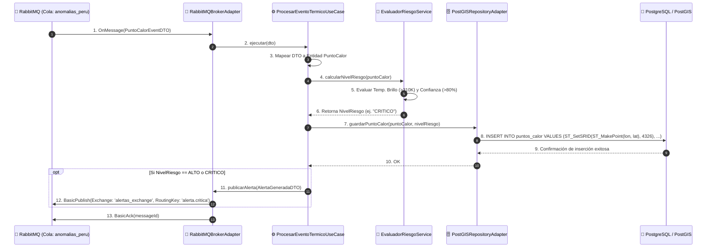
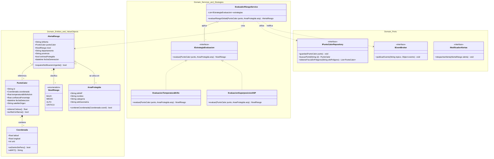

# Diseño Interno de Software: Principios, Patrones y Estructura de Módulos

---

## PARTE 1: Principios de Diseño SOLID

La aplicación de los principios **SOLID** en el diseño interno de los microservicios en Python/FastAPI garantiza que el núcleo de procesamiento de anomalías térmicas sea mantenible, extensible y fácil de probar.

### 1. SRP - Single Responsibility Principle (Principio de Responsabilidad Única)
Cada módulo y clase tiene una sola razón de cambio dentro de la arquitectura EDA:
* **`FIRMSIngestionService`:** Responsable exclusivamente de realizar el polling HTTP a la API de NASA FIRMS y obtener los datos crudos.
* **`EvaluadorRiesgoIncendio`:** Encargado únicamente de calcular la temperatura de brillo y clasificar la severidad del foco de calor (Bajo, Medio, Alto, Crítico).
* **`PuntoCalorRepository`:** Encargado en forma exclusiva de ejecutar las consultas de persistencia espacial (`ST_MakePoint`, `ST_Contains`) en PostGIS.
* **`RabbitMQPublisher`:** Encargado únicamente de formatear y serializar mensajes GeoJSON hacia las colas del bus de eventos.

### 2. OCP - Open/Closed Principle (Principio de Abierto/Cerrado)
Los módulos están abiertos a la extensión pero cerrados a la modificación:
* Mediante la interfaz `IEstrategiaEvaluacionRiesgo`, es posible incorporar nuevas reglas de clasificación de incendios (ejemplo: incorporar índices NDVI de Copernicus o datos meteorológicos de SENAMHI) creando una nueva clase sin modificar el motor principal de procesamiento CEP.

### 3. LSP - Liskov Substitution Principle (Principio de Sustitución de Liskov)
Las implementaciones concretas de proveedores de datos satelitales cumplen un contrato uniforme:
* Las clases `NASAFirmsAdapter`, `CopernicusAdapter` y `GOES16Adapter` implementan la interfaz `IFuenteSatelital`. Cualquier componente consumidor puede tratar a cualquiera de ellas indistintamente mediante el método `obtenerAnomalias()`, garantizando la sustitución sin alterar la lógica de la aplicación.

### 4. ISP - Interface Segregation Principle (Principio de Segregación de Interfaces)
Se definen contratos específicos y enfocados en lugar de interfaces monolíticas:
* **`INotificadorAlertas`:** Define únicamente el método `enviarAlerta(alerta: AlertaRiesgo)`.
* **`IAnomaliaReader`:** Define únicamente operaciones de lectura de coordenadas y temperaturas de brillo.
* Ningún componente está obligado a depender de métodos que no utiliza.

### 5. DIP - Dependency Inversion Principle (Principio de Inversión de Dependencias)
Los casos de uso del dominio dependen de abstracciones, no de detalles tecnológicos concretos:
* El caso de uso `ProcesarEventoTermicoUseCase` depende de las interfaces abstractas `IPuntoCalorRepository` y `IEventBroker`, en lugar de acoplarse directamente a las librerías concretas `psycopg2` o `pika` (RabbitMQ). Esto permite realizar pruebas unitarias con repositorios *Mock* sin necesidad de levantar bases de datos reales.

---

## PARTE 2: Patrones de Diseño Implementados

Para resolver problemas recurrentes en el procesamiento de eventos térmicos y la integración con servicios externos, se aplican los siguientes patrones GoF y de integración de sistemas:

### 1. Patrón Adapter (Estructural)
* **Propósito:** Convertir la respuesta cruda de la API externa de NASA FIRMS (formato CSV/JSON) a las entidades de dominio internas en formato **GeoJSON**.
* **Aplicación:** La clase `NASAFirmsAdapter` transforma atributos como `bright_ti4`, `confidence` y `latitude/longitude` en objetos de dominio estandarizados `PuntoCalor`.

### 2. Patrón Strategy (Comportamiento)
* **Propósito:** Permitir algoritmos intercambiables de evaluación del nivel de riesgo de incendios.
* **Aplicación:** El motor de reglas utiliza `EstrategiaTemperaturaBrillo` para análisis térmico básico, y puede cambiar en tiempo de ejecución a `EstrategiaCorrelacionANP` cuando el foco de calor se encuentra dentro de un Área Natural Protegida.

### 3. Patrón Repository (Persistencia)
* **Propósito:** Encapsular la lógica de acceso a datos espacio-temporales aislándola del dominio.
* **Aplicación:** `PuntoCalorPostGISRepository` encapsula las sentencias SQL espaciales de PostGIS (`ST_SetSRID`, `ST_MakePoint`, `ST_DWithin`), ofreciendo métodos limpios como `guardar_foco(punto)` y `obtener_activos_por_region(poligono)`.

### 4. Patrón Publish / Subscribe (Integración EDA)
* **Propósito:** Desacoplar la producción de anomalías térmicas del consumo de alertas.
* **Aplicación:** El servicio de ingesta actúa como *Publisher* enviando el evento `PuntoCalorDetectado` al Exchange de RabbitMQ. Los microservicios de evaluación de riesgo, persistencia en PostGIS y notificaciones se suscriben independientemente como *Subscribers*.

### 5. Patrón Circuit Breaker (Resiliencia)
* **Propósito:** Prevenir caídas en cascada cuando los servicios de NASA FIRMS o los gateways de SMS experimenten interrupciones o alta latencia.
* **Aplicación:** Interrumpe temporalmente las peticiones hacia la API externa tras 3 fallos consecutivos, activando una cola de reintentos asíncronos con tiempo de espera exponencial (*Exponential Backoff*).

---

## PARTE 3: Diseño Interno de Módulos (Clean Architecture)

### 1. Visión General
El diseño interno de los microservicios que componen la solución (`ms-ingesta-satelital`, `ms-procesador-cep`, `ms-notificaciones-alertas` y `ms-api-gateway`) adopta los principios de **Clean Architecture** (Arquitectura Limpia) y **Arquitectura Hexagonal (Puertos y Adaptadores)**.

El objetivo es mantener el núcleo del negocio (cálculo de temperaturas de brillo, delimitación geoespacial sobre el territorio peruano y evaluación de severidad de riesgo de incendios) completamente aislado de los detalles de infraestructura como marcos de trabajo (*FastAPI*), controladores de bases de datos (*PostGIS/SQLAlchemy*), clientes de mensajería (*RabbitMQ*) y proveedores satelitales (*NASA FIRMS API*).

## 2. Diagrama de Secuencia de Procesamiento Interno


## 3. Diagrama de Clases del Dominio de Evaluación de Riesgo


### 4. Estructura de Paquetes Internos

```text
ms-procesador-cep/
├── domain/                         # CAPA DE DOMINIO (Reglas de Negocio Puras)
│   ├── entities/                   # Entidades principales del dominio
│   │   ├── punto_calor.py
│   │   ├── alerta_riesgo.py
│   │   └── area_protegida.py
│   ├── services/                   # Servicios del dominio
│   │   ├── evaluador_riesgo_service.py
│   │   └── calculador_temperatura_service.py
│   ├── value_objects/              # Objetos de Valor inmutables
│   │   ├── coordenada.py
│   │   └── nivel_riesgo.py
│   └── ports/                      # Puertos (Interfaces abstractas)
│       ├── punto_calor_repository_port.py
│       ├── event_broker_port.py
│       └── notificador_port.py
│
├── application/                    # CAPA DE APLICACIÓN (Casos de Uso)
│   ├── use_cases/                  # Casos de uso de la aplicación
│   │   ├── procesar_evento_termico_use_case.py
│   │   ├── evaluar_riesgo_anp_use_case.py
│   │   └── consultar_focos_activos_use_case.py
│   └── dtos/                       # Data Transfer Objects (DTOs)
│       ├── punto_calor_event_dto.py
│       └── alerta_generada_dto.py
│
├── infrastructure/                 # CAPA DE INFRAESTRUCTURA (Adaptadores Concretos)
│   ├── adapters/                   # Adaptadores de Entrada y Salida
│   │   ├── postgis_repository_adapter.py
│   │   ├── rabbitmq_broker_adapter.py
│   │   ├── nasa_firms_client_adapter.py
│   │   └── sms_gateway_adapter.py
│   ├── db/                         # Configuración y modelos de ORM
│   │   ├── database.py
│   │   └── models.py
│   └── config/                     # Variables de entorno y configuración
│       └── settings.py
│
├── tests/                          # PRUEBAS AUTOMATIZADAS
│   ├── unit/                       # Pruebas unitarias del dominio
│   └── integration/                # Pruebas de integración con PostGIS/RabbitMQ
│
└── main.py                         # Punto de entrada (Worker / FastAPI App)
