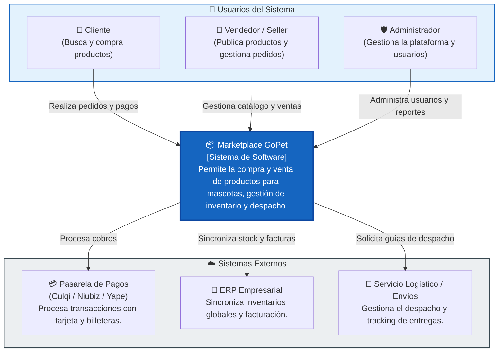

# C4 Nivel 1: Diagrama de Contexto del Sistema (System Context)

## 1. Descripción General
El Diagrama de Contexto proporciona una visión de alto nivel del **Marketplace de Productos para Mascotas (GoPet)**, mostrando las interacciones entre los diferentes usuarios principales y los sistemas externos con los que se integra la plataforma.

---

## 2. Diagrama de Contexto

---

## 3. Descripción de Actores y Sistemas

| Elemento | Tipo | Descripción |
| :--- | :--- | :--- |
| **Cliente** | Persona | Usuario final que explora el catálogo, agrega productos al carrito y realiza compras. |
| **Vendedor (Seller)** | Persona | Comercio registrado que gestiona sus productos, precios y solicitudes de pedido. |
| **Administrador** | Persona | Usuario interno encargado del monitoreo, soporte y gestión de permisos. |
| **Marketplace GoPet** | Sistema | Plataforma central que orquesta las operaciones de e-commerce. |
| **Pasarela de Pagos** | Sistema Externo | Servicio externo seguro encargado del cobro transaccional. |
| **ERP Empresarial** | Sistema Externo | Sistema de gestión empresarial para contabilidad e inventario consolidado. |
| **Servicio Logístico** | Sistema Externo | Empresa externa de envíos encargada de la entrega física del producto. |