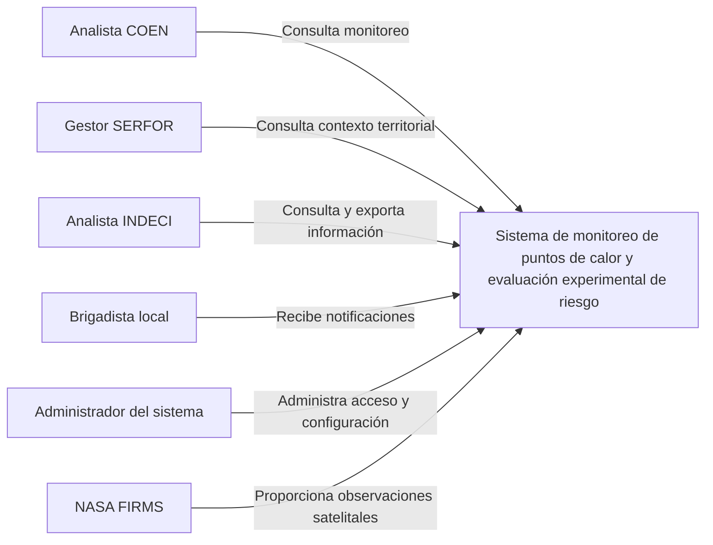

# C1 — Diagrama de Contexto del Sistema

Vista de contexto: solo muestra personas, el sistema de monitoreo y sistemas
externos. RabbitMQ, bases de datos y clases pertenecen a niveles posteriores.

El sistema trabaja con observaciones satelitales y evaluaciones
experimentales. No confirma incendios por sí mismo.
