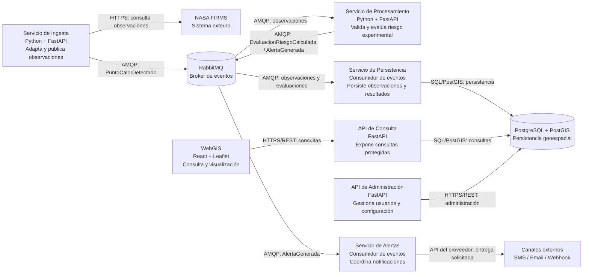

# C2 — Diagrama de Contenedores

En C4, un contenedor es una unidad de ejecución o almacenamiento relevante
para la arquitectura; no equivale necesariamente a un contenedor Docker.
Todos los elementos backend de esta vista son servicios propuestos.

La relación entre RabbitMQ y PostgreSQL siempre pasa por el Servicio de
Persistencia, que consume eventos y ejecuta el repositorio. La disponibilidad
de estas tecnologías queda pendiente de implementación.

## Relación con los módulos funcionales

| Contenedor C4 | Módulo o módulos atendidos |
| :--- | :--- |
| Servicio de Ingesta | Gestión de Datos Satelitales |
| Servicio de Procesamiento | Gestión de Puntos de Calor; Evaluación Experimental del Riesgo |
| Servicio de Persistencia | Gestión de Puntos de Calor |
| API de Consulta + WebGIS | Monitoreo Geoespacial |
| Servicio de Alertas | Gestión de Alertas |
| API de Administración | Administración del Sistema |
