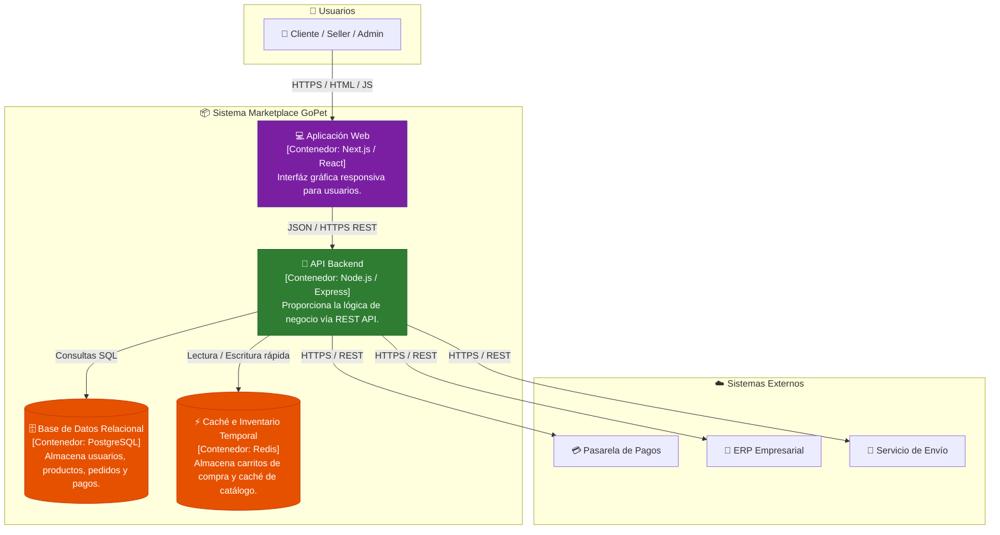

# C4 Nivel 2: Diagrama de Contenedores (Containers)

## 1. Descripción General
El Diagrama de Contenedores muestra la arquitectura de software de alto nivel, identificando las aplicaciones, bases de datos y almacenes de datos que componen el sistema GoPet.

---

## 2. Diagrama de Contenedores

---

## 3. Especificación de Contenedores

| Contenedor | Tecnología | Responsabilidad |
| :--- | :--- | :--- |
| **Aplicación Web** | Next.js / React, Tailwind | Interfaz de usuario para navegación, carrito y panel de administración. |
| **API Backend** | Node.js, Express, TypeScript | Procesa peticiones HTTP, aplica reglas de negocio y coordina módulos. |
| **Base de Datos** | PostgreSQL | Persistencia relacional con integridad transaccional ACID. |
| **Caché** | Redis | Almacenamiento en memoria para sesiones, carritos activos y catálogo frecuente. |