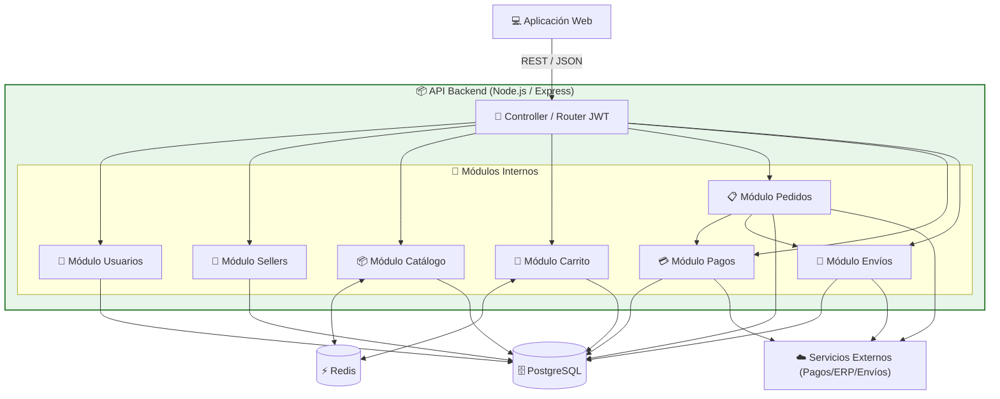

# C4 Nivel 3: Diagrama de Componentes (Components)

## 1. Descripción General
Descompone el contenedor **API Backend (Node.js / Express)** en sus módulos de negocio internos y sus conexiones.

---

## 2. Diagrama de Componentes del API Backend

---

## 3. Detalle de Componentes Internos

| Componente | Función Principal |
| :--- | :--- |
| **Router / Auth** | Autenticación mediante Tokens JWT y enrutamiento de peticiones. |
| **Módulo Usuarios** | Registro, autenticación y roles de acceso. |
| **Módulo Catálogo** | Gestión de productos para mascotas y sincronización de stock con Redis. |
| **Módulo Carrito** | Manejo de ítems seleccionados temporalmente por el cliente. |
| **Módulo Pedidos** | Orquestación central de órdenes de compra. |
| **Módulo Pagos** | Integración transaccional con la Pasarela de Pagos externa. |
| **Módulo Envíos** | Asignación de rutas y despacho con operadores logísticos. |