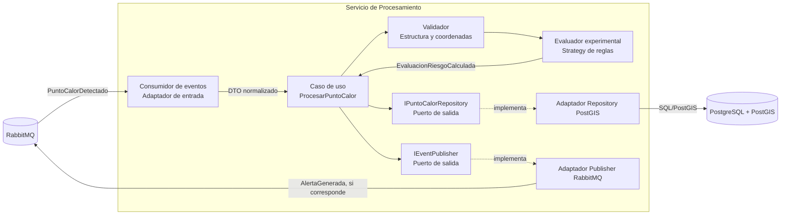

# C3 — Componentes del Servicio de Procesamiento

Diseño propuesto del servicio que consume observaciones y calcula una
evaluación experimental. No corresponde a clases existentes en el boilerplate
actual.

El caso de uso depende de interfaces. Las tecnologías solo aparecen en los
adaptadores.
