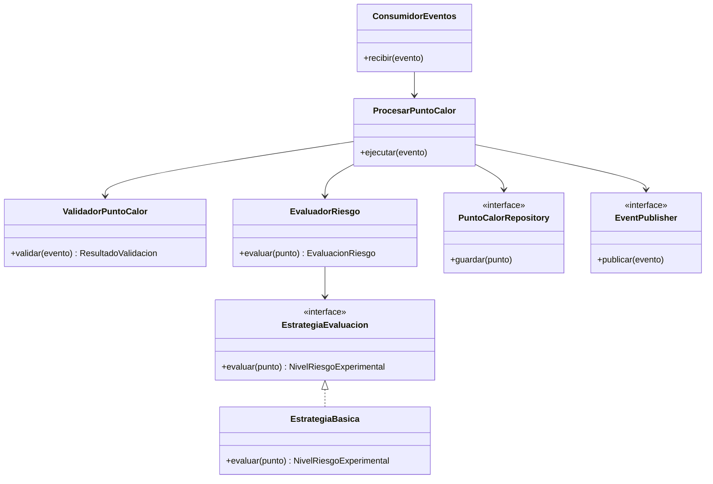

# C4 — Nivel de Código

## Diseño propuesto: componente `ProcesarPuntoCalor`

Este nivel representa clases e interfaces de un componente concreto. Los
tipos son diseño propuesto: no existen todavía en el código real del
repositorio.

Las reglas de `EstrategiaBasica` deben validarse experimentalmente. No se
define aquí un umbral térmico como confirmación de incendio.
