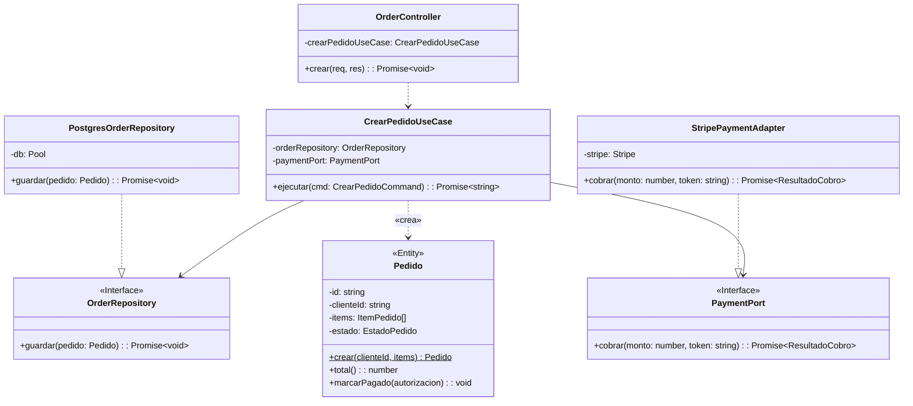
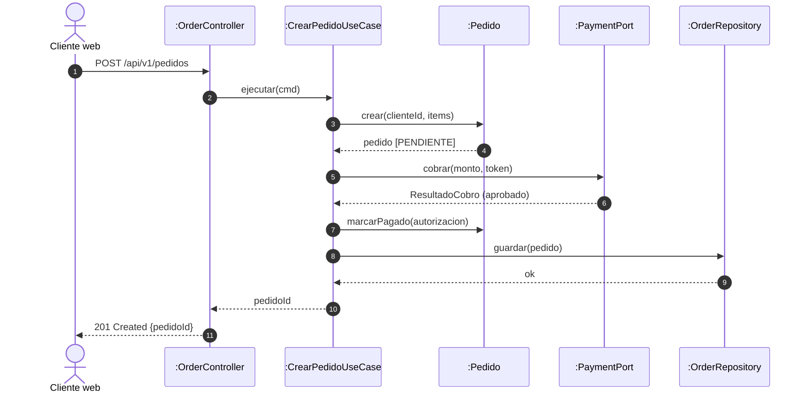

# C4 Nivel 4: Diagrama de Código (Code)

## 1. Descripción General
Muestra el diseño detallado de código dentro del módulo **Pedidos** aplicando principios de **Clean Architecture** y patrones de diseño.

---

## 2. Diagrama de Clases (Módulo Pedidos)

---

## 3. Diagrama de Secuencia (Flujo de Creación de Pedido)

