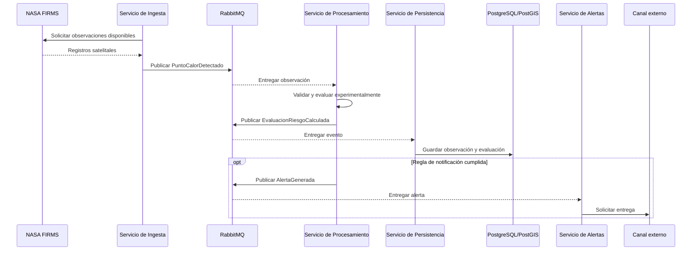

# Vista dinámica — Procesamiento de una observación

Esta secuencia complementa los niveles C4; no sustituye al C4 de código.
Representa un flujo propuesto y separa observación, procesamiento y
notificación.

Los tiempos de disponibilidad satelital, procesamiento y entrega deben medirse
por separado. La secuencia no demuestra latencia ni entrega instantánea.
